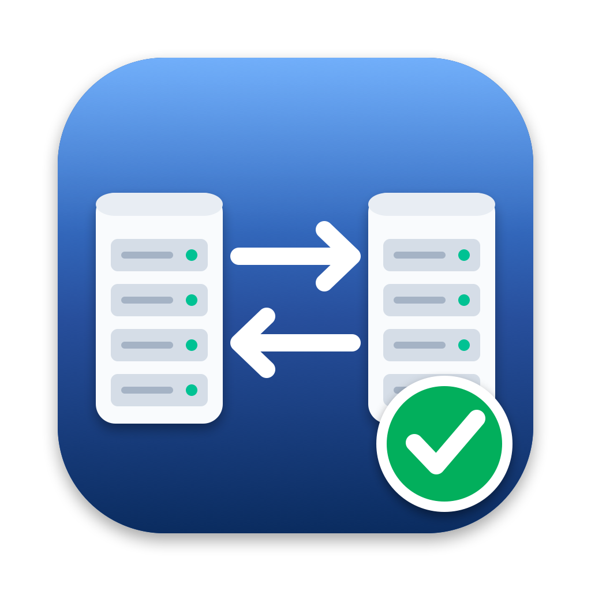

<p align="center"></p>

# NAS Mover

A Mac app for moving large amounts of data between a **QNAP** NAS and a **UniFi UNAS**: quickly, verifiably, and without Finder's endless "Preparing…".

- **Copy / Move:** parallel rsync over SSH, running *on the NAS*. Transfers keep going if the Mac sleeps or the app quits.
- **Unify:** compare two copies of the same project folder, review every difference, and make both sides match.
- **Verify:** every copy is checked with MD5 on both sides and recorded as an [ASC MHL](https://theasc.com/society/ascmitc/asc-media-hash-list) manifest (`ascmhl/` inside the folder), the same standard used by Hedge, ShotPut Pro and Silverstack. Re-check any folder later for silent corruption.
- **Browse:** look through either NAS, tick files and folders, see their sizes and delete them (handy for clearing duplicates). Deleted items go to the share's `_NAS Mover Recycle` folder. **Recycle Folders…** shows what's in each one and empties it permanently when you're sure. The Copy / Move folder picker has the same **Delete…** for ticked folders (or right-click a folder), so you can clear a duplicate right where you pick.
- **Nothing is permanently deleted** unless you empty a recycle folder yourself. Originals from a Move, and any files replaced or removed, go to a `_NAS Mover Recycle/<job>` folder at the root of that share. Empty it yourself once you've checked the result. It deliberately isn't the NAS's own recycle bin: QNAP's bin deletes files by age, which would remove old footage within hours.

## Install

On each Mac, paste this into Terminal:

```bash
curl -fsSL https://raw.githubusercontent.com/rustyhammers/nas-mover/main/install.sh | sh
```

This puts the latest version in `/Applications` and opens it. Or download the zip from [Releases](https://github.com/rustyhammers/nas-mover/releases), unzip it and drag it to Applications. The app isn't notarized by Apple, so the first time you open a browser-downloaded copy, macOS blocks it: go to **System Settings › Privacy & Security** and click **Open Anyway**.

On first launch:

1. Click **Allow** when macOS asks about finding devices on your local network.
2. The **Setup** screen connects the Mac to both NASes with SSH keys. You type each NAS password once to install the key; passwords are never stored.
   - **QNAP:** turn on SSH under *Control Panel › Network & File Services › Telnet/SSH*. Use an administrator account.
   - **UNAS:** turn on SSH and set its password in UniFi under *Settings › Control Plane › Console › Advanced*. The user is `root`.
   - **Link Them** lets the QNAP log in to the UNAS by itself; transfer jobs run on the QNAP.

## Updates

The app checks for updates daily and installs them with one click (via [Sparkle](https://sparkle-project.org)). To check now, choose **NAS Mover › Check for Updates…**. Updates are verified with an EdDSA signature before they're installed.

## Releasing a new version

```bash
scripts/release.sh 1.1.0 "- What changed"
```

This tags the commit and pushes it. GitHub Actions then:

1. Builds a universal (Apple silicon + Intel) app.
2. Signs the update.
3. Publishes the release with `appcast.xml`. Installed copies offer the update from there.

The workflow needs one repository secret, `SPARKLE_PRIVATE_KEY`: the base64 EdDSA private key whose public half is in `Resources/sparkle_public_key.txt`. Keep a backup of it; without it, installed copies can't verify new updates.

## Building from source

Needs macOS 14+ and the Swift toolchain (Xcode or its Command Line Tools).

```bash
./build.sh          # builds "NAS Mover.app" here
```

To regenerate the icon, run `swift scripts/make-icon.swift`.

## How it works

- The app talks to the NASes over SSH. All connections share one multiplexed session per NAS.
- A job is a folder in `~/.nasmover/jobs/` on the NAS that runs it, driven by `Resources/runner.sh`. The runner is a POSIX/busybox shell script the app uploads, so nothing has to be installed on the NAS.
- Copies use `rsync -rlt` with AES-GCM SSH and 4 parallel streams. A copy never overwrites a newer destination file (`-u`), and any file it replaces is kept in `_NAS Mover Recycle`.
- Verification MD5s both sides in parallel on each NAS. A Move only recycles the originals after every file matches.
- Files written to the UNAS are handed to the UniFi Drive owner and group (detected during Setup), so they show up normally over SMB.
- Each SSH call is logged on the Mac in `~/.nasmover/app.log`.
